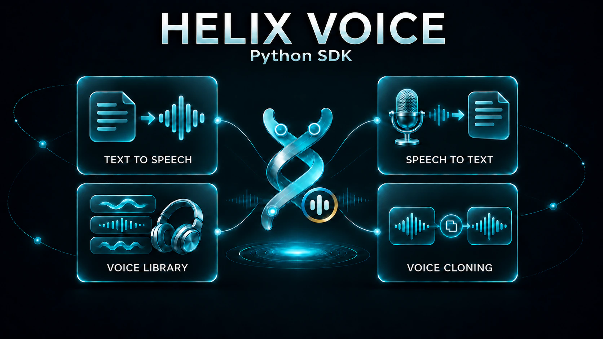

<p align="center">
  
</p>

<h1 align="center">Helix Voice SDK for Python</h1>

<p align="center">
  Generate speech, transcribe audio, and manage voices from your Python application.
</p>

<p align="center">
  <a href="https://pypi.org/project/helix-voice/"></a>
</p>

<p align="center">
  <a href="https://docs.helixvoice.net/">Developer Docs</a> ·
  <a href="examples/">Examples</a> ·
  <a href="https://pypi.org/project/helix-voice/#history">Version History</a>
</p>

## Install

Requires Python 3.9 or later. Install into your project's virtual environment.

```sh
python -m pip install helix-voice==0.2.0
```

## Quickstart

Set `HELIXVOICE_API_KEY` to a server-side API key with `voices:read`, `speech:write`, and `generations:read` scopes.

```sh
export HELIXVOICE_API_KEY='YOUR_API_KEY'
```

Save this as `speech.py` and run `python speech.py`.

```python
from helixvoice import HelixVoiceClient

with HelixVoiceClient() as client:
    voices = client.voices.list()
    if not voices:
        raise SystemExit("No voices are available to this account.")

    generation = client.speech.save(
        input="Hello from Helix Voice.",
        voice=voices[0].id,
        output="speech.wav",
    )

print(f"Saved speech.wav (generation {generation.id})")
```

On success, `speech.wav` is saved in your current directory and the generation ID is printed. The [repository example](examples/speech.py) also supports a custom API URL for staging or tests.

## API keys and account access

For production use, ask your account administrator for a scoped API key and set `HELIXVOICE_API_KEY` in your server environment. The speech example needs `voices:read` to look up a voice, `speech:write` to generate speech, and `generations:read` to download the WAV. Keep the key in server-side secret storage. [API keys and scopes](https://docs.helixvoice.net/en/api/authentication/)

The examples default to `https://api.helixvoice.net`. Set `HELIXVOICE_BASE_URL` when running them against a trusted staging or test API.

## Capabilities and scopes

| Operation | Required scope |
| --- | --- |
| Read service capabilities and limits | `capabilities:read` |
| List public and account-owned voices | `voices:read` |
| Clone or delete an owned voice | `voices:write` |
| Generate speech metadata | `speech:write` |
| Transcribe a Mandarin audio file | `transcriptions:write` |
| List generations or download WAV audio | `generations:read` |
| Delete generation history | `generations:write` |

Voice cloning requires explicit consent. Consult the capabilities response for the limits of your environment. [Developer API reference](https://docs.helixvoice.net/en/api/speech/)

## Troubleshooting

- **401 Unauthorized** means the key is missing, invalid, expired, or revoked. Check the key used by the running process.
- **403 Forbidden** with `insufficient_scope` means the key lacks a required permission. Check the scopes for each request.
- **429 Too Many Requests** means a quota or rate limit was reached. Honor `Retry-After` when available.
- **Speech generated but WAV saving failed** means you can recover the generation ID from the save error and retry the download while that record is retained. Retrying generation can consume quota again.

Keep the request ID when investigating an API error. [Errors and rate limits](https://docs.helixvoice.net/en/api/errors/) · [Generation downloads](https://docs.helixvoice.net/en/api/speech/#history-and-audio)

## License

Licensed under the [Apache License, Version 2.0](LICENSE).
